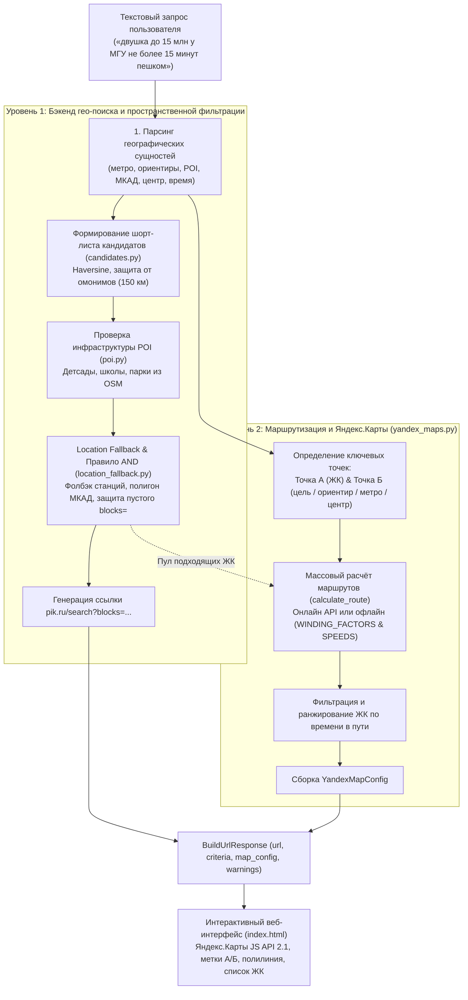
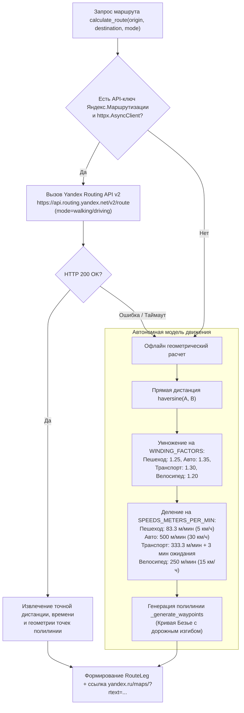

# Отчет: Механизм поиска по карте и интеграции с Яндекс.Картами в picurl

> **Назначение документа**: подробное описание того, как в проекте **picurl** устроен поиск по карте — от пространственного разбора и гео-сужения кандидатов до построения маршрутов, расчета времени в пути и интерактивной визуализации на Яндекс.Картах.

---

## 1. Общая архитектура: двухуровневая модель

В сервисе **picurl** понятие «поиск по карте» включает два тесно взаимодействующих уровня:

1. **Бэкенд-уровень гео-сужения (Geo-Narrowing & Spatial Filtering)**:
   - Детерминированное извлечение пространственных требований из текста (метро, ориентиры, класс линий, POI-инфраструктура, МКАД, центр).
   - Расчет дистанций по формуле Haversine по координатам станций метро (OSM), ориентиров и жилых комплексов ПИК.
   - Формирование шорт-листа подходящих ЖК с защитой от межрегиональных омонимов.
   - Построение URL-фильтра `blocks=` для `pik.ru/search` с соблюдением правила пересечения (AND) и защитой от снятия фильтра при пустом списке.
2. **Уровень маршрутизации и отображения (Interactive Yandex Maps & Routing)**:
   - Определение координат Точки А (ЖК-старт) и Точки Б (целевое назначение: метро, ориентир, центр).
   - Определение способа перемещения ([`TravelMode`](file:///var/lib/workflow-ai-workdir/test/tasks/320f10ed-2d61-4991-879f-ad2ce09b5b0f/app/geo/yandex_maps.py#L50-L77): пешком, на авто, на транспорте, на велосипеде).
   - Построение маршрута через Yandex Routing API либо автономный геометрический расчет с учетом извилистости дорог ([`WINDING_FACTORS`](file:///var/lib/workflow-ai-workdir/test/tasks/320f10ed-2d61-4991-879f-ad2ce09b5b0f/app/geo/yandex_maps.py#L39-L44)) и городских скоростей ([`SPEEDS_METERS_PER_MIN`](file:///var/lib/workflow-ai-workdir/test/tasks/320f10ed-2d61-4991-879f-ad2ce09b5b0f/app/geo/yandex_maps.py#L31-L36)).
   - Ранжирование и выборка подходящих ЖК по времени в пути («до 15 минут пешком»).
   - Интерактивный веб-интерфейс ([`index.html`](file:///var/lib/workflow-ai-workdir/test/tasks/320f10ed-2d61-4991-879f-ad2ce09b5b0f/app/templates/index.html)) на Яндекс.Картах JS API 2.1.

---

## 2. Уровень 1: Бэкенд гео-поиска и пространственной фильтрации

### 2.1. Извлечение пространственных параметров в парсере

Парсер [`parse(text)`](file:///var/lib/workflow-ai-workdir/test/tasks/320f10ed-2d61-4991-879f-ad2ce09b5b0f/app/parsing/parser.py#L82) применяет набор правил из пакета [`app/parsing/rules/`](file:///var/lib/workflow-ai-workdir/test/tasks/320f10ed-2d61-4991-879f-ad2ce09b5b0f/app/parsing/rules/) и сопоставление по локальным справочникам:

1. **Метро, округа, районы, комплексы** ([`app/parsing/entity_match.py`](file:///var/lib/workflow-ai-workdir/test/tasks/320f10ed-2d61-4991-879f-ad2ce09b5b0f/app/parsing/entity_match.py)):
   - Нечеткий поиск через `rapidfuzz` по локальным JSON-справочникам: [`metro.json`](file:///var/lib/workflow-ai-workdir/test/tasks/320f10ed-2d61-4991-879f-ad2ce09b5b0f/app/reference/metro.json), [`counties.json`](file:///var/lib/workflow-ai-workdir/test/tasks/320f10ed-2d61-4991-879f-ad2ce09b5b0f/app/reference/counties.json), [`districts.json`](file:///var/lib/workflow-ai-workdir/test/tasks/320f10ed-2d61-4991-879f-ad2ce09b5b0f/app/reference/districts.json), [`complexes.json`](file:///var/lib/workflow-ai-workdir/test/tasks/320f10ed-2d61-4991-879f-ad2ce09b5b0f/app/reference/complexes.json).
   - Скользящее окно из 1–4 слов, нормализация гомоглифов (латиница → кириллица 1:1 в [`normalize`](file:///var/lib/workflow-ai-workdir/test/tasks/320f10ed-2d61-4991-879f-ad2ce09b5b0f/app/reference/loader.py#L115-L123)).
2. **Ориентиры (Landmarks)** ([`app/parsing/rules/landmark.py`](file:///var/lib/workflow-ai-workdir/test/tasks/320f10ed-2d61-4991-879f-ad2ce09b5b0f/app/parsing/rules/landmark.py)):
   - Распознает вузы, работодателей, парки, стадионы (МГУ, МФТИ, Бауманка, Политех, Сити, Сколково, Парк Горького и др.) из [`landmarks.json`](file:///var/lib/workflow-ai-workdir/test/tasks/320f10ed-2d61-4991-879f-ad2ce09b5b0f/app/reference/landmarks.json).
   - Маркеры близости: «рядом с», «у», «недалеко от», «близко к», «вблизи», «около».
   - Суперлативы: «самую ближайшую к», «ближе всего к», «как можно ближе к» → выставляется флаг `nearest_only=True` в [`LandmarkRequirement`](file:///var/lib/workflow-ai-workdir/test/tasks/320f10ed-2d61-4991-879f-ad2ce09b5b0f/app/parsing/schema.py#L210-L224).
   - Дистанционные суффиксы: «не дальше 1.5 км», «в пределах 800 м» → заполняется `max_distance_m`.
3. **Класс станций и линии метро** ([`app/parsing/rules/station_class.py`](file:///var/lib/workflow-ai-workdir/test/tasks/320f10ed-2d61-4991-879f-ad2ce09b5b0f/app/parsing/rules/station_class.py)):
   - «любое метро», «у коричневой ветки», «метро кольцевой линии», «рядом с МЦД / МЦД-2».
   - Формирует [`StationClassRequirement`](file:///var/lib/workflow-ai-workdir/test/tasks/320f10ed-2d61-4991-879f-ad2ce09b5b0f/app/parsing/schema.py#L226-L236).
4. **Инфраструктура и POI** ([`app/parsing/rules/poi.py`](file:///var/lib/workflow-ai-workdir/test/tasks/320f10ed-2d61-4991-879f-ad2ce09b5b0f/app/parsing/rules/poi.py)):
   - Распознает требования к детским садам, школам, паркам, фитнесу, поликлиникам, ТЦ, стоматологии.
   - Переводит «до 10 минут пешком» в метры (800 м) в [`POIRequirement`](file:///var/lib/workflow-ai-workdir/test/tasks/320f10ed-2d61-4991-879f-ad2ce09b5b0f/app/parsing/schema.py#L198-L208).
5. **МКАД и Центр Москвы** ([`app/parsing/rules/misc.py`](file:///var/lib/workflow-ai-workdir/test/tasks/320f10ed-2d61-4991-879f-ad2ce09b5b0f/app/parsing/rules/misc.py)):
   - «внутри МКАД» (`within_mkad=True`) или «за МКАД» (`within_mkad=False`).
   - «в центре», «в пределах Садового/ТТК» (`center_requested=True`).
6. **Ограничения времени в пути** ([`app/parsing/rules/time.py`](file:///var/lib/workflow-ai-workdir/test/tasks/320f10ed-2d61-4991-879f-ad2ce09b5b0f/app/parsing/rules/time.py)):
   - «до 15 минут пешком» → `time_on_foot = 15`.
   - «до 25 минут на машине/транспорте» → `time_on_transport = 25`.

---

### 2.2. Расчет расстояний и построение шорт-листа кандидатов

Основная логика пространственного анализа сосредоточена в модуле [`app/geo/candidates.py`](file:///var/lib/workflow-ai-workdir/test/tasks/320f10ed-2d61-4991-879f-ad2ce09b5b0f/app/geo/candidates.py):

#### Источники координат (только официальные факты, Инварианты 3 и 6):
- **Станции метро**: координаты в [`metro.json`](file:///var/lib/workflow-ai-workdir/test/tasks/320f10ed-2d61-4991-879f-ad2ce09b5b0f/app/reference/metro.json), полученные из OpenStreetMap через [`refresh_metro_geo.py`](file:///var/lib/workflow-ai-workdir/test/tasks/320f10ed-2d61-4991-879f-ad2ce09b5b0f/app/reference/refresh_metro_geo.py).
- **Жилые комплексы ПИК**: точные `lat` и `lon` в [`complexes.json`](file:///var/lib/workflow-ai-workdir/test/tasks/320f10ed-2d61-4991-879f-ad2ce09b5b0f/app/reference/complexes.json), получаемые из API ПИК (`api.pik.ru/v2/block`).
- **Ориентиры**: координаты в [`landmarks.json`](file:///var/lib/workflow-ai-workdir/test/tasks/320f10ed-2d61-4991-879f-ad2ce09b5b0f/app/reference/landmarks.json).
- **МКАД**: замкнутый полигон 108 точек в [`mkad_ring.json`](file:///var/lib/workflow-ai-workdir/test/tasks/320f10ed-2d61-4991-879f-ad2ce09b5b0f/app/reference/mkad_ring.json).
- **Расстояние**: чистая математика формулы гаверсинусов [`haversine(lat1, lon1, lat2, lon2)`](file:///var/lib/workflow-ai-workdir/test/tasks/320f10ed-2d61-4991-879f-ad2ce09b5b0f/app/geo/distance.py#L24-L39) (сфера R = 6371 км).

#### Алгоритм [`build_candidate_shortlist`](file:///var/lib/workflow-ai-workdir/test/tasks/320f10ed-2d61-4991-879f-ad2ce09b5b0f/app/geo/candidates.py#L283-L506):
1. **Якоря запроса (Anchors)**:
   - Из названных пользователем станций метро извлекаются координаты ([`_requested_metro_points`](file:///var/lib/workflow-ai-workdir/test/tasks/320f10ed-2d61-4991-879f-ad2ce09b5b0f/app/geo/candidates.py#L508-L521)).
   - У округов и районов координат нет, и выдумывать центроиды запрещено (Инвариант 3).
2. **Тег-матч и фильтрация по омонимам (Защита Д3)**:
   - Если пользователь указал район/округ/метро, сопоставляются текстовые поля ЖК (`district`, `county`, `metro`).
   - Функция [`_split_by_geo_plausibility`](file:///var/lib/workflow-ai-workdir/test/tasks/320f10ed-2d61-4991-879f-ad2ce09b5b0f/app/geo/candidates.py#L219-L249) проверяет расстояние каждого ЖК до якорных станций: если ЖК находится дальше `TAG_MATCH_ANCHOR_RADIUS_M = 150 км`, он отсекается как омоним другого региона (например, питерский ЖК «Таллинский парк» с районом «Ломоносовский»).
   - Формируется предупреждение [`TAG_MATCH_HOMONYM_WARNING`](file:///var/lib/workflow-ai-workdir/test/tasks/320f10ed-2d61-4991-879f-ad2ce09b5b0f/app/geo/candidates.py#L110-L113).
3. **Фолбэк при пустом совпадении тегов**:
   - Если ни один ЖК не совпал по тегам или все оказались омонимами, запускается детерминированное дистанционное ранжирование ([`_rank_by_location_points`](file:///var/lib/workflow-ai-workdir/test/tasks/320f10ed-2d61-4991-879f-ad2ce09b5b0f/app/geo/candidates.py#L524-L551)) относительно названных станций.
   - Пользователю сообщается реальное расстояние до ближайшего ЖК («ЖК с привязкой к X нет — показаны ближайшие по расстоянию, от N.NN км по прямой»).
4. **Ранжирование по ориентирам ([`_rank_by_landmark`](file:///var/lib/workflow-ai-workdir/test/tasks/320f10ed-2d61-4991-879f-ad2ce09b5b0f/app/geo/candidates.py#L553-L588))**:
   - Для каждого кандидата считается минимальное расстояние до заданных ориентиров.
   - При наличии `max_distance_m` применяется жесткая отсечка.
   - **Инвариант 13**: усечение до лимита (`SHORTLIST_LIMIT = 50`) происходит **строго после** сортировки по дистанции.
5. **Ранжирование по классу станций ([`_rank_by_station_class`](file:///var/lib/workflow-ai-workdir/test/tasks/320f10ed-2d61-4991-879f-ad2ce09b5b0f/app/geo/candidates.py#L630-L656))**:
   - Отбираются координаты станций нужной линии (`line_prefix`, напр. «Кольцевая», «МЦД-2»).
   - Кандидаты сортируются по дистанции до ближайшей станции линии.
6. **Проверка POI (Инфраструктура)**:
   - Данные читаются из [`poi_cache.json`](file:///var/lib/workflow-ai-workdir/test/tasks/320f10ed-2d61-4991-879f-ad2ce09b5b0f/app/reference/poi_cache.json) (радиус сбора 2 км).
   - Функция [`is_operational`](file:///var/lib/workflow-ai-workdir/test/tasks/320f10ed-2d61-4991-879f-ad2ce09b5b0f/app/geo/poi.py#L72-L96) в схеме v2 отсекает стройплощадки и недостроенные объекты (префиксы `construction:`, `planned:`).
   - Если требуемой категории нет в кэше, она помечается через [`POI_CATEGORY_NOT_CACHED_WARNING`](file:///var/lib/workflow-ai-workdir/test/tasks/320f10ed-2d61-4991-879f-ad2ce09b5b0f/app/geo/poi.py#L57-L60), предотвращая ложное «ничего не найдено».

---

### 2.3. Правило AND и Location Fallback в URL

Модуль [`app/pik/location_fallback.py`](file:///var/lib/workflow-ai-workdir/test/tasks/320f10ed-2d61-4991-879f-ad2ce09b5b0f/app/pik/location_fallback.py) решает фундаментальное ограничение бэкенда ПИК:

> [!IMPORTANT]
> Бэкенд валидации `api.pik.ru/v2/filter` игнорирует параметры `metroStations`, `districtLocations`, `districtCounties` и применяет **исключительно** фильтр `blocks` (список id жилых комплексов). Кроме того, часть станций в справочниках не имеет подтвержденного GUID.

Порядок работы гео-фолбэка ([`resolve_fallback_block_ids`](file:///var/lib/workflow-ai-workdir/test/tasks/320f10ed-2d61-4991-879f-ad2ce09b5b0f/app/pik/location_fallback.py#L257-L324)):
1. Для станций без подтвержденного id проверяется прямой тег-матч привязки ЖК.
2. Если тегом ЖК не найдены — берется радиус 1.5 км ([`STATION_CLASS_DEFAULT_RADIUS_M`](file:///var/lib/workflow-ai-workdir/test/tasks/320f10ed-2d61-4991-879f-ad2ce09b5b0f/app/geo/candidates.py#L68)) от координат станции, либо (если в радиусе пусто) 8 ближайших ЖК ([`STATION_CLASS_FALLBACK_LIMIT`](file:///var/lib/workflow-ai-workdir/test/tasks/320f10ed-2d61-4991-879f-ad2ce09b5b0f/app/geo/candidates.py#L85)).
3. Для «внутри/за МКАД»: алгоритмом ray-casting по полигону ([`point_in_mkad`](file:///var/lib/workflow-ai-workdir/test/tasks/320f10ed-2d61-4991-879f-ad2ce09b5b0f/app/geo/mkad.py#L35-L56)) фильтруются ЖК нужной стороны кольца.
4. **Правило AND ([`combine_with_fallback`](file:///var/lib/workflow-ai-workdir/test/tasks/320f10ed-2d61-4991-879f-ad2ce09b5b0f/app/pik/location_fallback.py#L114-L164))**:
   - Списки ЖК всегда **пересекаются**, а не объединяются (`existing ∩ fallback`).
   - И `build_url`, и `validate` обязаны использовать единую функцию `combine_with_fallback` (устранение 6.5-кратного расхождения выдачи).
5. **Защита Д1 (Пустой `blocks=`)**:
   - На pik.ru пустой параметр `blocks=` не означает «0 ЖК», а **снимает фильтр**, показывая пользователю весь город.
   - Если расчёт дал 0 ЖК: параметр `blocks=` в ссылку **не добавляется**, отдается сужение по метро/району и честно выдается предупреждение [`LOCATION_ZERO_MATCH_NOT_APPLIED_WARNING`](file:///var/lib/workflow-ai-workdir/test/tasks/320f10ed-2d61-4991-879f-ad2ce09b5b0f/app/pik/location_fallback.py#L99-L103).

---

## 3. Уровень 2: Интерактивные Яндекс.Карты и маршрутизация

Вся логика взаимодействия с Яндекс.Картами, построения маршрутов и оценки времени в пути инкапсулирована в [`app/geo/yandex_maps.py`](file:///var/lib/workflow-ai-workdir/test/tasks/320f10ed-2d61-4991-879f-ad2ce09b5b0f/app/geo/yandex_maps.py).

### 3.1. Структуры данных

- [`TravelMode`](file:///var/lib/workflow-ai-workdir/test/tasks/320f10ed-2d61-4991-879f-ad2ce09b5b0f/app/geo/yandex_maps.py#L50-L77):
  - `PEDESTRIAN` ("pedestrian", "пешком", Яндекс rtt: `"pd"`)
  - `DRIVING` ("driving", "на машине", Яндекс rtt: `"auto"`)
  - `TRANSIT` ("transit", "на транспорте", Яндекс rtt: `"mt"`)
  - `BICYCLE` ("bicycle", "на велосипеде", Яндекс rtt: `"bc"`)
- [`GeoPoint`](file:///var/lib/workflow-ai-workdir/test/tasks/320f10ed-2d61-4991-879f-ad2ce09b5b0f/app/geo/yandex_maps.py#L80-L93):
  - `lat`, `lon` (координаты точки)
  - `name` (название точки, напр. «ЖК Матвеевский парк» или «МГУ им. Ломоносова»)
  - `address` (текстовое описание)
  - `point_type`: `"origin"` (Точка А) или `"destination"` (Точка Б)
- [`RouteLeg`](file:///var/lib/workflow-ai-workdir/test/tasks/320f10ed-2d61-4991-879f-ad2ce09b5b0f/app/geo/yandex_maps.py#L95-L114):
  - `origin`, `destination` (точки А и Б)
  - `travel_mode` (способ перемещения)
  - `distance_m`, `formatted_distance` (напр. `"1.2 км"`)
  - `duration_min`, `duration_sec`, `formatted_duration` (напр. `"15 мин пешком"`)
  - `waypoints`: список пар `[[lat, lon], ...]`, представляющий полилинию маршрута
  - `yandex_maps_url`: прямая ссылка для открытия маршрута в веб-версии Яндекс.Карт
- [`YandexMapConfig`](file:///var/lib/workflow-ai-workdir/test/tasks/320f10ed-2d61-4991-879f-ad2ce09b5b0f/app/geo/yandex_maps.py#L116-L162):
  - `center`: `[lat, lon]` центра карты
  - `zoom`: масштаб (от 10 до 15 в зависимости от расстояния)
  - `point_a`, `point_b`: объекты `GeoPoint`
  - `route`: основной выбранный маршрут `RouteLeg`
  - `all_complex_routes`: список маршрутов от всех подходящих ЖК до Точки Б (топ-10 по времени)
  - `selected_travel_time_min`: запрошенное пользователем ограничение времени в пути

---

### 3.2. Определение ключевых точек А и Б

В функции [`_resolve_destination_point`](file:///var/lib/workflow-ai-workdir/test/tasks/320f10ed-2d61-4991-879f-ad2ce09b5b0f/app/geo/yandex_maps.py#L334-L390):
1. **Точка Б (Destination / Назначение)**:
   - **Приоритет 1 (Ориентир)**: если распознан `criteria.landmark_requirements`, берутся его координаты и название (например, МГУ, 55.7028, 37.5305).
   - **Приоритет 2 (Метро)**: если в критериях есть станции `criteria.metro`, берутся координаты из `metro.json`.
   - **Приоритет 3 (Текстовый ориентир)**: прямой поиск вхождений названий и алиасов ориентиров в тексте запроса.
   - **Приоритет 4 (Центр Москвы)**: если запрошен центр (`criteria.center_requested=True`), назначаются координаты Кремля (55.75222, 37.61556).
2. **Точка А (Origin / Старт)**:
   - Жилой комплекс ПИК из пула кандидатов ([`_get_complex_entries`](file:///var/lib/workflow-ai-workdir/test/tasks/320f10ed-2d61-4991-879f-ad2ce09b5b0f/app/geo/yandex_maps.py#L393-L410)).
   - Если Точка Б не определена, Точкой А становится первый ЖК каталога, и карта просто центрируется на нем без построения маршрута.

---

### 3.3. Определение способа перемещения ([`detect_travel_mode`](file:///var/lib/workflow-ai-workdir/test/tasks/320f10ed-2d61-4991-879f-ad2ce09b5b0f/app/geo/yandex_maps.py#L310-L332))

Способ передвижения и запрошенное ограничение времени определяются по структурированным критериям и лексике запроса:

| Условие | `TravelMode` | Запрошенное время |
|---|---|---|
| В тексте «машина», «авто», «такси» или `criteria.time_on_transport` с авто-контекстом | `DRIVING` | `criteria.time_on_transport` (если задано) |
| `criteria.time_on_transport` или слова «транспорт», «метро», «автобус» | `TRANSIT` | `criteria.time_on_transport` (если задано) |
| `criteria.time_on_foot` или умолчание | `PEDESTRIAN` | `criteria.time_on_foot` (если задано) |
| В тексте «велосипед», «самокат», «на веле» | `BICYCLE` | `None` |

---

### 3.4. Расчёт маршрута ([`calculate_route`](file:///var/lib/workflow-ai-workdir/test/tasks/320f10ed-2d61-4991-879f-ad2ce09b5b0f/app/geo/yandex_maps.py#L209-L307))

Реализована гибридная двухрежимная маршрутизация:

#### Параметры скоростей и коэффициенты извилистости:
- **`SPEEDS_METERS_PER_MIN`**:
  - `pedestrian`: 83.33 м/мин (~5 км/ч)
  - `driving`: 500.0 м/мин (~30 км/ч с учетом московского трафика)
  - `transit`: 333.33 м/мин (~20 км/ч) + 3 мин на ожидание/пересадку ([`TRANSIT_FIXED_OVERHEAD_MIN`](file:///var/lib/workflow-ai-workdir/test/tasks/320f10ed-2d61-4991-879f-ad2ce09b5b0f/app/geo/yandex_maps.py#L47))
  - `bicycle`: 250.0 м/мин (~15 км/ч)
- **`WINDING_FACTORS`**:
  - `pedestrian`: 1.25
  - `driving`: 1.35
  - `transit`: 1.30
  - `bicycle`: 1.20
- **Генерация полилинии ([`_generate_waypoints`](file:///var/lib/workflow-ai-workdir/test/tasks/320f10ed-2d61-4991-879f-ad2ce09b5b0f/app/geo/yandex_maps.py#L179-L206))**:
  - Рассчитывает квадратичную кривую Безье со смещением перпендикулярно вектору движения, создавая реалистичную дугу маршрута по улицам.
- **Прямая ссылка на Яндекс.Карты**:
  - `https://yandex.ru/maps/?rtext={origin.lat},{origin.lon}~{destination.lat},{destination.lon}&rtt={rtt_code}`
  - Открывает маршрут в один клик в нативном интерфейсе Яндекс.Карт.

---

### 3.5. Сборка полного контекста карты ([`build_map_context`](file:///var/lib/workflow-ai-workdir/test/tasks/320f10ed-2d61-4991-879f-ad2ce09b5b0f/app/geo/yandex_maps.py#L412-L519))

1. Из критериев или каталога извлекаются все подходящие ЖК с координатами.
2. Определяется Точка Б (ориентир / станция / центр).
3. Для каждого ЖК строится маршрут до Точки Б.
4. Маршруты сортируются по времени в пути (`duration_sec`).
5. Если задан лимит времени (например, «до 15 минут пешком»):
   - ЖК фильтруются условием `r.duration_min <= requested_time_min`.
   - Основным ЖК (Точкой А) выбирается самый быстрый из подошедших.
6. Вычисляется географический центр между Точкой А и Точкой Б и подбирается оптимальный `zoom` (15 при дистанции < 1.5 км, 14 при < 4 км, 12 при < 10 км, 11 при < 25 км, иначе 10).
7. Формируется итоговый объект [`YandexMapConfig`](file:///var/lib/workflow-ai-workdir/test/tasks/320f10ed-2d61-4991-879f-ad2ce09b5b0f/app/geo/yandex_maps.py#L116-L162).

---

## 4. API и пользовательский веб-интерфейс

### 4.1. HTTP API

В [`app/api/endpoints.py`](file:///var/lib/workflow-ai-workdir/test/tasks/320f10ed-2d61-4991-879f-ad2ce09b5b0f/app/api/endpoints.py):
1. **`POST /build-url`**:
   - Принимает `{ "text": "..." }`.
   - Проводит полный пайплайн: `parse()` → `enrich()` → `build_url()` → `validate()` → `build_map_context()`.
   - В теле ответа [`BuildUrlResponse`](file:///var/lib/workflow-ai-workdir/test/tasks/320f10ed-2d61-4991-879f-ad2ce09b5b0f/app/api/schemas.py#L106-L125) возвращает объект `map_config`.
2. **`POST /api/geo/route`**:
   - Позволяет фронтенду перестроить маршрут между точками А и Б при смене способа передвижения (пешком ↔ авто ↔ транспорт ↔ велосипед) без повторного текстового разбора.
3. **`GET /map` и `GET /`**:
   - Отдает HTML-шаблон [`app/templates/index.html`](file:///var/lib/workflow-ai-workdir/test/tasks/320f10ed-2d61-4991-879f-ad2ce09b5b0f/app/templates/index.html) с динамической подстановкой API-ключа Яндекс.Карт.

### 4.2. Веб-интерфейс ([`index.html`](file:///var/lib/workflow-ai-workdir/test/tasks/320f10ed-2d61-4991-879f-ad2ce09b5b0f/app/templates/index.html))

- **Автоматическая инициализация**: скрипт JS API Яндекс.Карт 2.1 подключается в `<head>`, при старте вызывается `ymaps.ready()`, центрируя карту на Москве.
- **Отображение маркеров**:
  - Точка А (ЖК): пресет `islands#orangeHomeIcon` (оранжевая иконка дома с балуном названия ЖК).
  - Точка Б (Назначение): пресет `islands#nightDotIcon` (темная точка с балуном ориентира/метро).
- **Отрисовка маршрута**: `ymaps.Polyline` оранжевого цвета шириной 5px с хинтом дистанции и времени.
- **Автозумирование**: `myMap.setBounds(bounds, { zoomMargin: [60, 60, 60, 60] })` аккуратно вписывает обе точки и маршрут в экран.
- **Интерактивный список ЖК**:
  - Карточки ЖК с расчетом времени («12 мин пешком», «24 мин на авто»).
  - Клик по карточке ЖК мгновенно переключает Точку А и перерисовывает маршрут на карте.
- **Интерактивные кнопки режимов**: переключение между «пешком», «на авто», «транспорт», «велосипед».
- **Внешние ссылки**: кнопка перехода к нативным Яндекс.Картам и кнопка перехода на отфильтрованный поиск `pik.ru`.

---

## 5. Сводная таблица параметров и эвристик

| Константа / Параметр | Значение | Где определено | Назначение |
|---|---|---|---|
| `SHORTLIST_LIMIT` | 50 | [`candidates.py`](file:///var/lib/workflow-ai-workdir/test/tasks/320f10ed-2d61-4991-879f-ad2ce09b5b0f/app/geo/candidates.py#L26) | Лимит ЖК-кандидатов шорт-листа (после сортировки) |
| `CENTER_RADIUS_M` | 5000 м | [`distance.py`](file:///var/lib/workflow-ai-workdir/test/tasks/320f10ed-2d61-4991-879f-ad2ce09b5b0f/app/geo/distance.py#L11) | Эвристический радиус центра Москвы |
| `STATION_CLASS_DEFAULT_RADIUS_M` | 1500 м | [`candidates.py`](file:///var/lib/workflow-ai-workdir/test/tasks/320f10ed-2d61-4991-879f-ad2ce09b5b0f/app/geo/candidates.py#L68) | Дефолтный радиус пешей доступности до станции |
| `STATION_CLASS_FALLBACK_LIMIT` | 8 | [`candidates.py`](file:///var/lib/workflow-ai-workdir/test/tasks/320f10ed-2d61-4991-879f-ad2ce09b5b0f/app/geo/candidates.py#L85) | Сколько ближайших ЖК показать при пустом радиусе |
| `TAG_MATCH_ANCHOR_RADIUS_M` | 150 000 м (150 км) | [`candidates.py`](file:///var/lib/workflow-ai-workdir/test/tasks/320f10ed-2d61-4991-879f-ad2ce09b5b0f/app/geo/candidates.py#L105) | Порог отсечения межрегиональных омонимов (Д3) |
| `POI_CACHE_RADIUS_M` | 2000 м | [`poi.py`](file:///var/lib/workflow-ai-workdir/test/tasks/320f10ed-2d61-4991-879f-ad2ce09b5b0f/app/geo/poi.py#L40) | Радиус сбора объектов инфраструктуры вокруг ЖК |
| `TRANSIT_FIXED_OVERHEAD_MIN` | 3 мин | [`yandex_maps.py`](file:///var/lib/workflow-ai-workdir/test/tasks/320f10ed-2d61-4991-879f-ad2ce09b5b0f/app/geo/yandex_maps.py#L47) | Добавочное время на ожидание/пересадку транспорта |
| `WINDING_FACTORS["pedestrian"]` | 1.25 | [`yandex_maps.py`](file:///var/lib/workflow-ai-workdir/test/tasks/320f10ed-2d61-4991-879f-ad2ce09b5b0f/app/geo/yandex_maps.py#L40) | Коэффициент извилистости пешеходного пути |
| `WINDING_FACTORS["driving"]` | 1.35 | [`yandex_maps.py`](file:///var/lib/workflow-ai-workdir/test/tasks/320f10ed-2d61-4991-879f-ad2ce09b5b0f/app/geo/yandex_maps.py#L41) | Коэффициент извилистости дорожной сети |
| `SPEEDS_METERS_PER_MIN["pedestrian"]`| 83.33 м/мин | [`yandex_maps.py`](file:///var/lib/workflow-ai-workdir/test/tasks/320f10ed-2d61-4991-879f-ad2ce09b5b0f/app/geo/yandex_maps.py#L32) | Скорость ходьбы (~5 км/ч) |
| `SPEEDS_METERS_PER_MIN["driving"]` | 500.0 м/мин | [`yandex_maps.py`](file:///var/lib/workflow-ai-workdir/test/tasks/320f10ed-2d61-4991-879f-ad2ce09b5b0f/app/geo/yandex_maps.py#L33) | Скорость авто с трафиком (~30 км/ч) |

---

## 6. Ключевые архитектурные инварианты

1. **Инвариант 3 (LLM не считает координаты и расстояния)**:
   Гео-сужение и маршруты — чистая геометрия и официальные координаты из справочников. LLM получает расстояния только как готовый факт.
2. **Инвариант 13 (Усечение после сортировки)**:
   Любые списки кандидатов усекаются до лимитов строго после расчета расстояний и ранжирования, чтобы не потерять реально ближайшие дома.
3. **Инвариант 16 (Фолбэк станций)**:
   Фолбэк станций включается только при дефолтном радиусе. Явно заданный пользователем радиус является жестким отсекателем.
4. **Правило AND (Пересечение, а не объединение)**:
   Гео-сужение всегда пересекается со списком уже отобранных ЖК. При пустом пересечении побеждает более специфичное требование с явным предупреждением.
5. **Защита от невыразимого нуля (Д1)**:
   Пустой параметр `blocks=` на pik.ru снимает фильтр и открывает весь город. Поэтому нулевое пересечение никогда не транслируется в пустой `blocks=`.
